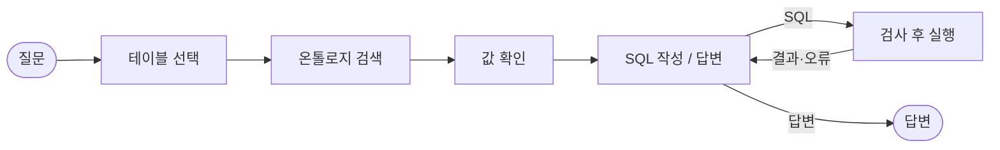

# financial-product-agent

금융상품 데이터에 자연어로 질문하면, 필요한 테이블을 골라 SQL로 조회·집계하고 그 결과에 근거해 답하는 에이전트입니다.
데이터로 답할 수 없는 질문에는 지어내지 않고 이유를 밝혀 거절합니다.
LangGraph와 HyperCLOVA X(`HCX-007`)로 만들었습니다.

## 결과

같은 코드·모델·채점 규칙에서 구성만 바꿔 3회씩 측정한 평균입니다.

| 구성 | 골든 30문항 (튜닝에 사용) | 홀드아웃 30문항 (튜닝하지 않음) |
|---|---|---|
| 기본 | 5.3 / 30 | 4.3 / 30 |
| + 온톨로지 컨텍스트 (`--ontology abc`) | 11.0 / 30 | 9.0 / 30 |
| + 코드 강제·값 확인 (`--enforce --slots`) | **28.3 / 30** | **20.3 / 30** |

온톨로지로 정답의 근거를 컨텍스트에 넣는 것만으로는 부족했습니다. 문항마다 정답에 필요한 항목만 골라 넣어 줘도(진단용 실험) 30문항 중 10~11개만 맞혔습니다.
기계적으로 판단할 수 있는 것을 코드가 맡자 정답이 크게 늘었습니다. 다만 골든에서 뽑은 개념이 홀드아웃 질문까지 충분히 일반화되지는 못했습니다.

## 핵심 아이디어

- **온톨로지: 스키마에 없는 의미를 정의합니다.** 테이블마다 다른 '판매 가능' 조건, 글자가 아닌 순서로 비교해야 하는 신용등급('AA- 이상'), 실제 값인 0과 미입력인 0의 구분 같은 것입니다. YAML로 쓰고 PostgreSQL에 적재해, 질문마다 필요한 용어·규칙만 검색해 프롬프트에 넣습니다.
- **역할 분리: LLM은 해석하고 코드는 강제합니다.** LLM은 테이블 선택, 질문 해석, SQL 작성, 답변 작성만 합니다. 코드가 SQL을 고쳐 쓰고(`DESC NULLS LAST`, 미입력 0 제외), 규칙 위반을 실행 전에 막고, 오류 위치와 고치는 방법을 LLM에 돌려줍니다.
- **값 확인: 질문 속 값을 DB에 저장된 값과 대조합니다.** 상품명·발행기관·등급·분류를 실제 저장된 값으로 확인해 SQL 조건으로 넘깁니다.

## 구조



- **테이블 선택**: 질문에 필요한 테이블을 고릅니다.
- **온톨로지 검색** (`--ontology`): 선택된 테이블의 지식과, 질문으로 검색한 용어·규칙을 프롬프트에 붙입니다.
- **값 확인** (`--slots`): 질문의 이름·등급·범주 값을 뽑아 DB와 대조합니다.
- **SQL 작성 / 답변**: SQL을 쓰거나 답합니다. 쿼리는 최대 3번 실행합니다.
- **검사 후 실행**: 단일 `SELECT`와 허용된 테이블만 통과시키고, 읽기 전용 트랜잭션에서 15초 제한으로 실행합니다. `--enforce`를 켜면 규칙 검사와 SQL 재작성이 더해집니다.

## 데이터

PostgreSQL `public` 스키마의 테이블 5개, 약 13만 행입니다. **데이터는 이 저장소에 포함되어 있지 않습니다.**

| 테이블 | 내용 |
|---|---|
| `pref01n001` | 국내 ETF·ETN |
| `pref02n001` | 해외 ETF·ETN |
| `prfd01n001` | 펀드 (클래스 단위) |
| `prbd01n001` | 채권 |
| `domestic_etf_holdings` | 국내 ETF 구성종목 |

## 실행

필요한 것: Python 3.13 이상, [uv](https://docs.astral.sh/uv/), 위 테이블이 있는 PostgreSQL(온톨로지 검색에는 pgvector도 필요), CLOVA Studio API 키.

```bash
uv sync
cp .env.example .env    # DB 접속 정보와 API 키를 채운다
uv run python scripts/build_schema_cache.py    # DB에서 스키마 카탈로그 생성
```

```bash
uv run financial-product-agent    # 대화 모드 (/new: 새 대화, exit: 종료)
uv run financial-product-agent -q "삼성전자를 편입한 국내 ETF는 몇 개야?" --show-sql
uv run financial-product-agent -q "질문" --show-sql --ontology abc --enforce --slots    # 전체 구성
```

| 옵션 | 기본값 | 내용 |
|---|---|---|
| `--show-sql` | - | 선택된 테이블과 실행한 SQL을 함께 출력합니다 |
| `--ontology off\|ab\|abc` | `off` | 온톨로지를 프롬프트에 넣습니다. `abc`는 질문으로 용어·규칙을 검색해 더합니다 |
| `--enforce` | off | 규칙을 코드가 강제합니다(SQL 재작성, 실행 전 차단, 답변에 적용 조건 첨부) |
| `--slots` | off | 질문 속 값을 DB에 저장된 값과 대조합니다 |

## 평가

- **골든 30문항**(`golden/questions_v2.yaml`)으로 개선하고, **홀드아웃 30문항**(`golden/holdout_v2.yaml`)으로 일반화를 잽니다. 홀드아웃 점수를 보고는 고치지 않습니다.
- 분류: 조건 탐색 7, 연산·집계 7, 순위 5, 관계 탐색 6, 비교 2, 답변 불가 3.
- 채점에 LLM을 쓰지 않습니다. 에이전트의 SQL을 다시 실행해 정답과 값으로 비교하고, 답변에 핵심 값과 필수 언급이 있는지 확인합니다. 답변 불가 문항은 데이터에 없는 이유를 밝혀 거절해야 정답입니다.
- 해석 정책과 채점 규칙은 [`golden/design.md`](golden/design.md)에 있습니다.

## HyperCLOVA X 제약

- `tool_choice`(강제 도구 호출)를 지원하지 않습니다. 그냥 도구를 붙이면 "조회해 보겠습니다"라고만 쓰고 끝나는 일이 있어서, 테이블 선택과 SQL 생성을 구조화 출력으로 합니다.
- 도구 호출과 구조화 출력은 `thinking={"effort": "none"}`일 때만 동작합니다.
- 한도가 분당 요청 60회, 토큰 6만 개라서 프롬프트에는 선택된 테이블의 정보만 넣고, 429 응답에는 15초 이상 기다렸다가 재시도합니다.

## 디렉터리

| 경로 | 내용 |
|---|---|
| `src/financial_product_agent/` | 에이전트 패키지 |
| `scripts/` | 스키마 카탈로그 생성, 온톨로지 적재·임베딩, 골든 정답 생성·채점 |
| `tests/` | pytest |
| `golden/` | 골든·홀드아웃 문항과 평가 설계 |
| `ontology/` | 온톨로지 YAML(정본)과 PostgreSQL 스키마 |
| `data/` | 스키마 카탈로그와 측정 결과 (gitignore) |

## 개발

```bash
uv run pytest -m "not db and not llm"    # DB·API 없이 도는 테스트
uv run pytest                            # 전체 (PostgreSQL과 HyperCLOVA X 필요)
uv run ruff check
```

`tests/test_golden_eval.py`와 `tests/test_ontology.py`는 DB에서 만든 파일(`data/schema_catalog.json`, 골든 정답 스냅샷)이 있어야 돕니다.

DB가 필요한 작업:

```bash
uv run python scripts/load_ontology.py    # ontology/*.yaml → knowledge 스키마
uv run python scripts/embed_ontology.py   # 바뀐 용어·규칙 임베딩
uv run python scripts/verify_golden.py    # 골든 정답 스냅샷 생성
uv run python scripts/eval_golden.py --label <이름> --ontology abc --enforce --slots    # 골든 채점
```
